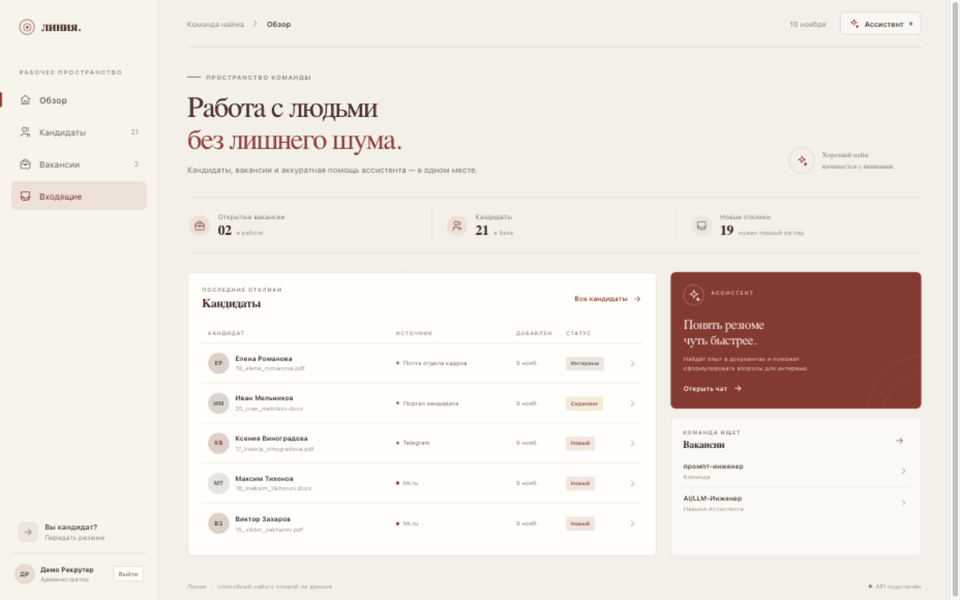
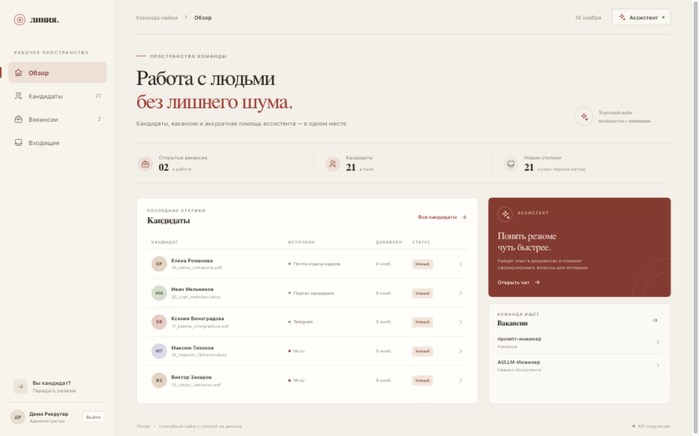
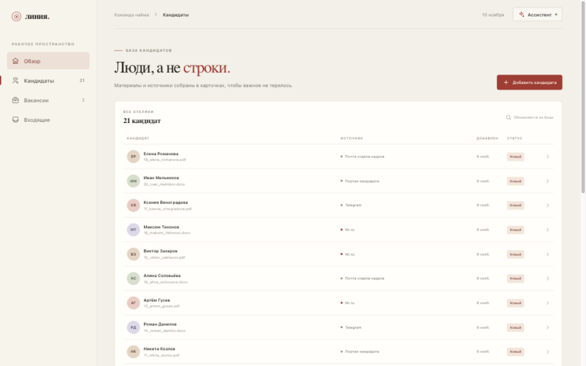
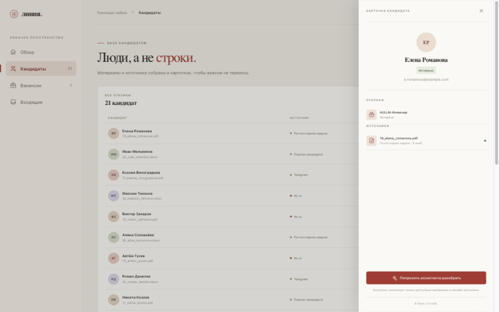
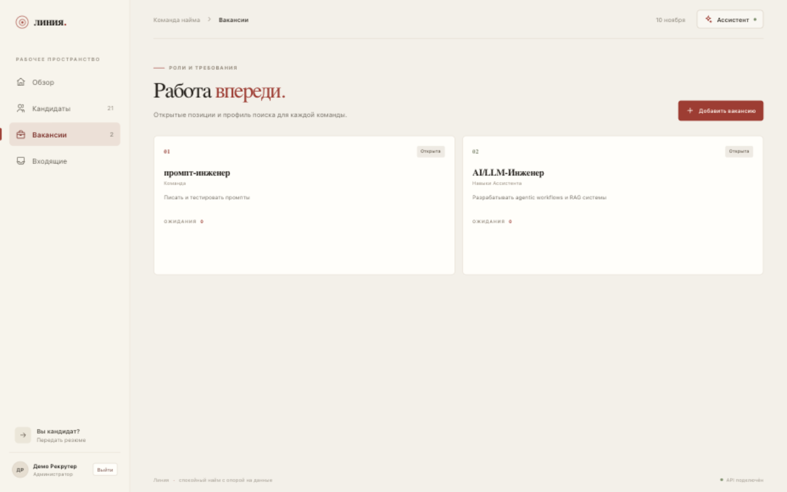
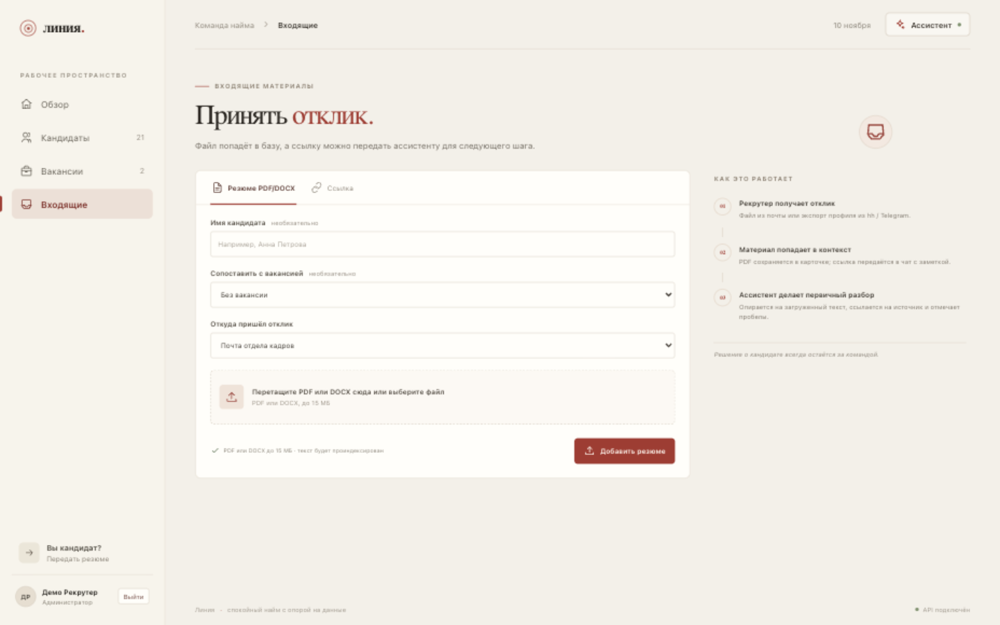
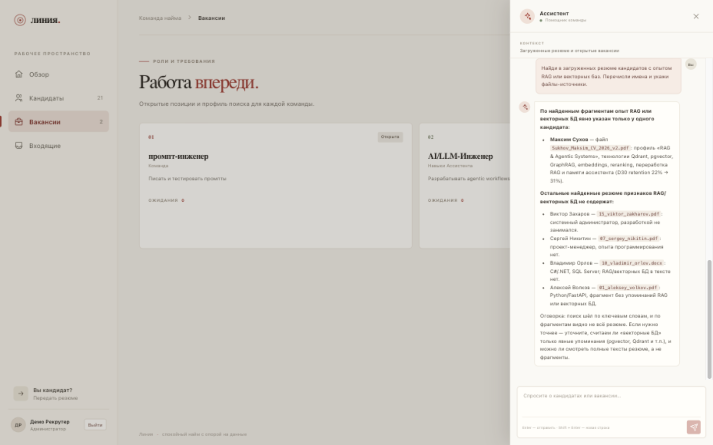

# Линия — HR assistant monorepo

[](https://github.com/MaksSuhov/hr-assistant/actions/workflows/ci.yml)

Минималистичное рабочее пространство для найма: API на FastAPI, веб-интерфейс на React и Vite, загрузка резюме, поиск по документам и чат с ассистентом.

## Интерфейс



| Обзор | Кандидаты |
| --- | --- |
|  |  |
| **Карточка кандидата с откликами** | **Вакансии** |
|  |  |
| **Приём отклика** | **Ассистент со ссылками на источники** |
|  |  |

На скриншотах — синтетический корпус и демонстрационные отклики; реальных персональных данных нет.

## Структура

```text
apps/
  api/    FastAPI backend и оценка качества
  web/    React frontend и страница загрузки для кандидата
```

## Запуск всего проекта

Нужны запущенный Docker Desktop (или Docker Engine с Compose) и терминал. Все команды ниже вводите **из корневой папки проекта**, где лежит `docker-compose.yml`.

1. Откройте `.env` из шаблона:

   ```bash
   cp .env.example .env
   ```

   Откройте `.env` в редакторе и вставьте ключ провайдера в `OPENAI_API_KEY=...`. Без ключа сайт и API запустятся, но чат и индексация резюме работать не будут.

   Шаблон включает `APP_ENV=development` и заглушку `AUTH_SECRET_KEY`. Для боевого запуска поставьте `APP_ENV=production` и замените секрет случайным значением не короче 32 символов: `python -c "import secrets; print(secrets.token_urlsafe(48))"`. Иначе API откажется стартовать.

2. В той же папке запустите сборку и сервисы:

   ```bash
   docker compose up --build
   ```

   При первом запуске Docker скачает образы и соберёт API и сайт — это может занять несколько минут. **Не закрывайте этот терминал:** команда остаётся на переднем плане и показывает логи. Дождитесь окончания сборки и сообщений о запуске API; пока Docker ещё собирает образы, сайт может не открываться.

3. Когда команда продолжает работать без ошибок, откройте в браузере:

   - **Сайт рекрутера:** [http://localhost:3000](http://localhost:3000)
   - **Загрузка резюме кандидатом:** [http://localhost:3000/candidate](http://localhost:3000/candidate)
   - **API и его документация:** [http://localhost:8000/docs](http://localhost:8000/docs)

   Если хотите проверить состояние контейнеров, оставьте первый терминал открытым и выполните во втором, также из корня проекта, команду `docker compose ps`. Сервисы `web`, `api` и `qdrant` должны иметь состояние `Up` или `running`.

Чтобы остановить проект, нажмите `Ctrl+C` в первом терминале. Если запускаете в фоне, используйте `docker compose up --build -d`, смотрите запуск через `docker compose logs -f`, а останавливайте через `docker compose down`.

Если сайт не открылся, проверьте, что Docker работает, `.env` создан в корне проекта, а порты `3000` и `8000` свободны. Для подробной ошибки сборки посмотрите вывод команды; для логов уже запущенных сервисов выполните `docker compose logs --tail=100 web api`.

Данные резюме и SQLite хранятся в Docker volume `hr_data`, индекс — в `qdrant_data`.

## Локальная разработка

Из корня проекта установите и запустите API в Python 3.11+ окружении:

```bash
python -m pip install -e apps/api
uvicorn hr_assistant.main:app --app-dir apps/api/src --reload
```

Веб-приложение требует Node.js 22.12+:

```bash
npm install
npm run dev
```

Vite проксирует `/api` на `http://localhost:8000`. Для сборки используйте `npm run build`.

## Проверка качества

В репозитории настроены `ruff`, `mypy` и `pytest`. Из корня проекта:

```bash
make install   # pip install -e "apps/api[dev]"
make check     # ruff, форматирование, mypy и тесты с покрытием
make web-build # npm ci + tsc + vite build
```

Тесты backend не обращаются к OpenAI, Qdrant и SMTP: внешние сервисы заменены фейками, SQLite создаётся во временном каталоге, поэтому прогон занимает секунды и не требует ключей. Те же проверки выполняет GitHub Actions на Python 3.12 (`.github/workflows/ci.yml`), дополнительно собирая фронтенд и Docker-образы.

## Результаты оценки качества

Прогон 10 ноября 2026 года: `python -m eval pipeline` на синтетическом корпусе из 21 резюме (PDF и DOCX). Пайплайн сам сгенерировал 10 вопросов по свежим резюме (7 negative, 2 comparison, 1 fact), прогнал их через обычный `ChatService.stream_chat` и оценил LLM-судьёй, который видел весь корпус, а не только пять найденных фрагментов. Модель ответов и судьи — `deepseek/deepseek-v4.1-flash-1017`, реранкер — локальный `BAAI/bge-reranker-v2-m3-int8`. Ошибок генерации и ответов — 0.

| Метрика | Результат | Что означает |
| --- | --- | --- |
| `faithfulness` | **0.96** | Утверждения ответа подтверждаются переданными фрагментами резюме. |
| `answer_relevancy` | **0.90** | Ответ отвечает на заданный вопрос, а не уходит в сторону. |
| `context_relevancy` | **0.43** | Доля фрагментов, относящихся к вопросу; на каждый вопрос возвращалось по 5 фрагментов, обычно релевантен один. |
| `context_precision` | **0.20** | Точность ранжирования при одном релевантном кандидате и пяти контекстах: 1/5 — потолок этого формата, а не оценка реранкера. |
| `context_recall` | **1.00** | Reference answer покрыт найденными контекстами. |
| `corpus_faithfulness` | **0.98** | Ответ не противоречит резюме, которые судья видит во всём корпусе, включая не найденные ретривером. |
| `corpus_completeness` | **—** | Не применилась: в прогоне не было list-вопросов, а сравнения были внутри одного кандидата. |

TTFT в этом batch-прогоне (`concurrency=2`, включая HyDE, гибридный поиск и tool-call) — медиана **16,1 с**, p95 **16,8 с**; полный ответ — медиана **17,5 с**. Это не бенчмарк одиночного интерактивного запроса: задержка приходит из вызовов chat-модели, включая HyDE, а не из локального реранка, и её сокращение вынесено в планы ниже.

Повторить замер:

```bash
docker compose exec -T api python -m eval pipeline --limit 10 --concurrency 2 --output /tmp/report.json
```

21 резюме и 10 вопросов — smoke test, а не статистически значимая выборка: цифры показывают работоспособность пайплайна и отсутствие грубых ошибок, но не заменяют ручную разметку на реальном корпусе.

## Ограничения и что дальше

Проект собран как один узел. Решения ниже осознанны для демо и локального запуска, но не рассчитаны на поток вроде 10 000 резюме в день. Это граница текущей версии, а не скрытый долг.

**Инфраструктура и данные**

- SQLite, `create_all` и ручные идемпотентные миграции вместо Alembic: один писатель, нет реплик и горизонтального масштабирования.
- Rate limit хранится в памяти процесса. При нескольких воркерах лимиты станут общими только после переезда на Redis; сейчас uvicorn запускается одним воркером.
- Индексация синхронная: загрузка ждёт эмбеддинги и запись в Qdrant. Нет очереди, ретраев и отдельного воркера, поэтому медленный провайдер или недоступный Qdrant напрямую влияют на запрос.
- Qdrant — один контейнер без репликации. Файлы резюме лежат на локальном volume, а не в S3-совместимом хранилище; резервного копирования нет.
- Ретенция запускается на старте приложения и по админскому эндпоинту, а не планировщиком.
- Реранкер — локальная ONNX-модель на процесс: около 0,6 ГБ в кэше, загрузка при первом поиске, нагрузка на CPU. Несколько воркеров загрузят несколько копий.
- Один OpenAI-совместимый провайдер без fallback: недоступность шлюза останавливает чат, HyDE и разбор резюме.

**Продукт и интерфейс**

- Смена стадии, удаление, слияние кандидатов и переиндексация доступны через API, но не через кнопки в интерфейсе.
- `App.tsx` — монолит на ~570 строк без тестов и ESLint; фронтенд проверяется только `tsc` и сборкой.
- Аутентификация — cookie-сессии с ролями `admin`/`recruiter`; нет подтверждения email, сброса пароля, MFA и изоляции арендаторов.
- `/health` не проверяет зависимости глубоко, а наблюдаемость ограничена логами и Langfuse; метрик, алертов и трейсинга инфраструктуры нет.

**AI и оценка**

- Judge — одна LLM-модель без человеческих меток, поэтому возможна её предвзятость к собственным ответам; 21 резюме и 10 вопросов — только smoke test.
- Live-группы `retrieval` и `performance` пока не отправляют `access_token` и CSRF-пару, поэтому против защищённого API получают 401; in-process `pipeline` этого ограничения не имеет.
- HyDE добавляет отдельный вызов LLM к каждому поиску, а TTFT около 16 с в batch-прогоне делает интерактивный чат медленным.
- Внешние ссылки hh/Telegram не открываются: для разбора нужен PDF/DOCX или текст профиля.

**Что дальше, по приоритету**

1. PostgreSQL + Alembic, Redis для rate limit, очередь и воркеры для индексации с ретраями и статусами.
2. Починить авторизацию live-групп eval и добавить в пайплайн retrieval-метрики (hit-rate, MRR, MAP) на размеченном корпусе.
3. Сократить TTFT: профилирование tool-loop и модели, кэш HyDE, отдельный быстрый профиль для первого токена.
4. Добавить в UI смену стадии, удаление, слияние и переиндексацию; разбить `App.tsx` и покрыть фронтенд тестами.
5. Закрыть продуктовую безопасность: сброс пароля, подтверждение email, MFA для админа, объектное хранилище и бэкапы.
6. Сделать `/health` зависимостным, добавить метрики и алерты; описать деплой на несколько узлов.

## Как устроен приём откликов

- Рекрутер загружает PDF или DOCX из почты, hh или Telegram. Backend извлекает текст (для сканов — через OCR), создаёт или находит карточку кандидата по email/телефону/тексту и индексирует резюме; интерфейс просит ассистента сделать первичный разбор.
- Рекрутер может сразу выбрать вакансию: создаётся отклик «кандидат ↔ вакансия» со своей стадией. Один кандидат может находиться на разных стадиях в разных вакансиях.
- Рекрутер может передать ссылку hh/Telegram ассистенту вместе с контекстом. В текущей версии внешние страницы не открываются: для разбора содержимого нужен экспортированный PDF/DOCX или текст профиля. Ассистент должен явно сообщить об этом, а не делать вывод по одной ссылке.
- Кандидат загружает PDF или DOCX через отдельную страницу `/candidate`; создаётся карточка с источником «Портал кандидата».
- Загрузка дубликата распознаётся и привязывается к существующей карточке; для повторной индексации есть `POST /resumes/{id}/reindex`, а удаление кандидата каскадно очищает файлы, записи и векторный индекс.
- Ассистент ищет только по материалам, загруженным в базу. Он не принимает решения о найме; действия команды требуют отдельного подтверждения.

Подробности API, конфигурация провайдера и инструменты оценки — в [документации backend](apps/api/README.md).
